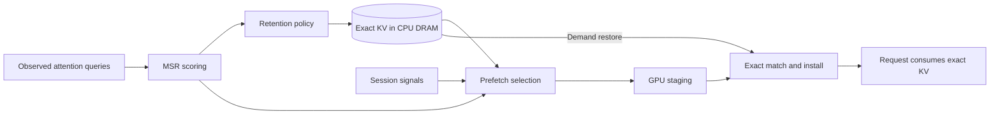

# MSR semantic cache for vLLM

An experimental vLLM extension for exact KV-cache offload, semantic retention,
and causal prefetch. The project explores **mean semantic relevance (MSR)** as a
cache policy alongside LRU and ARC.

**Development is paused.** This is a research prototype, not a production-ready
cache backend. The accepted experiments preserve exact output and KV identity,
but the combined MSR-retention and semantic-prefetch system has **not** shown a
repeatable provider benefit against matched ARC/LRU controls.

## Current standing

The strongest positive result is policy-agnostic. In E04, native
`store_threshold=2` reduced writes by 99.790% and improved the semantic arm's
mean TTFT by 22.50%, ITL by 19.78%, throughput by 14.93%, and makespan by 12.00%
versus its neutral configuration. Matched ARC also benefited from threshold 2
and remained ahead of semantic by point estimate: semantic TTFT was 3.17% worse,
ITL 4.76% worse, throughput 2.70% lower, and makespan 5.12% longer. Those cells
performed no restores or prefetches, so E04 supports a generic admission guard,
not a semantic-policy or prefetch win.

The final combined-system campaign reached exact causal semantic selection and
consumption, then closed as a scoped negative:

- A26 repeated three matched 48-request traces. MSR+semantic executed 120,174
  prompt tokens versus 119,918 for ARC/LRU in every trace (+0.2135%), used 3.56%
  more measured model-runner time than ARC, and transferred 12.40% more H2D data.
- A27 used one genuinely disjoint 48-request trace. MSR+semantic selected and
  consumed the returning source, but tied ARC/LRU on prompt work while using
  4.94% more model-runner time, with 6.23% worse median TTFT and 6.37% lower
  throughput than ARC.

These results rule out the tested revisions and inputs as release-benefit
evidence; they do not establish that MSR can never help. The
[curated evidence snapshot](evidence/README.md) gives the full denominators,
controls, hashes, and limitations.

## Architecture

MSR ranks exact KV candidates using compact summaries derived from observed
attention queries. Retention manages CPU-resident exact KV; prefetch can stage a
causally selected prefix back to GPU before demand. Exact prefix, model, adapter,
layout, and position identity—not semantic similarity—determine whether KV may
be installed and reused.



The package is named `semantic-offload` and targets a narrow prerelease vLLM
compatibility range. Reproduction requires pinned extension and vLLM revisions.
The tested DRAM comparisons explicitly set `store_threshold=2`; it is not a
global runtime default.

## Repository map

```text
semantic_offload/  Runtime policy, scoring, exact transfer, and lifecycle code
benchmarks/        Serving workloads and result analysis
harness/           Server launch and workload utilities
tests/             Correctness and measurement checks
evidence/          Curated reports, validation, and result summary
docs/              Project timeline and future-work overview
```

See the [project history](docs/PROJECT_HISTORY.md) for the experiment timeline
and [future work](docs/FUTURE_WORK.md) for the unfinished optimization and
measurement backlog. Multi-gigabyte raw runs remain outside Git. No new GPU work
is scheduled while the project is paused.
