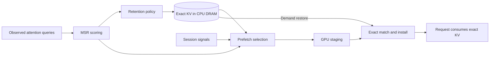

# MSR KV Cache Eviction for vLLM

Mean Semantic Relevance (MSR is an experimental vLLM extension for exact KV-cache offload, semantic retention,
and causal prefetch.

## Architecture

MSR ranks exact KV candidates using compact summaries derived from observed
attention queries. Retention manages CPU-resident exact KV; prefetch can stage a
causally selected prefix back to GPU before demand. Exact prefix, model, adapter,
layout, and position identity—not semantic similarity—determine whether KV may
be installed and reused.



The package is named `semantic-offload` and targets a narrow prerelease vLLM
compatibility range. Reproduction requires pinned extension and vLLM revisions.
The tested DRAM comparisons explicitly set `store_threshold=2`; it is not a
global runtime default.

## How to use

Install the extension with its supported vLLM range:

```bash
python -m pip install -e '.[cache-affinity]'
```

MSR is selected through vLLM's KV connector configuration. The public helper
returns the complete configuration, including mean-semantic retention and its
paired semantic prefetch:

```python
import json

from semantic_offload.config import msr_kv_transfer_config

config = msr_kv_transfer_config(
    cpu_bytes_to_use=8 * 1024**3,  # 8 GiB CPU KV tier
)
print(json.dumps(config))
```

Pass that JSON to `vllm serve`:

```bash
vllm serve Qwen/Qwen2.5-1.5B-Instruct \
  --kv-transfer-config '{
    "kv_connector": "SemanticOffloadingConnector",
    "kv_connector_module_path": "semantic_offload.connector",
    "kv_role": "kv_both",
    "kv_connector_extra_config": {
      "spec_name": "SemanticOffloadingSpec",
      "spec_module_path": "semantic_offload.spec",
      "cpu_bytes_to_use": 8589934592,
      "method": "mean",
      "store_threshold": 2,
      "prefetch_budget_fraction": 0.05,
      "prefetch_selector": "semantic",
      "prefetch_score_max_age_ms": 1000
    }
  }'
```

The helper defaults to preemption-triggered semantic prefetch. Set
`prefetch_budget_fraction` to control how much of the GPU block pool may be
reserved speculatively; it must be greater than zero to enable prefetch. The
current implementation requires pipeline and context parallel sizes of one,
does not support MLA KV caches, and requires the vLLM version range declared in
`pyproject.toml`. Treat the configuration as experimental and pin both projects
when reproducing results.

## Results

In the strongest individual comparison, MSR semantic prefetch consumed the staged exact KV and reduced median time to first token by 0.80% versus ARC. Prompt work and transfer volume were unchanged.

| Metric | ARC | MSR | MSR vs. ARC |
|---|---:|---:|---:|
| Executed prompt tokens | 94,748 | 94,748 | 0.00% |
| Median TTFT | 166.088 ms | 164.756 ms | **−0.80%** |
| Makespan | Baseline | — | +0.17% |
| Throughput | Baseline | — | −0.17% |
| H2D transfer | 2,752,512 bytes | 2,752,512 bytes | 0.00% |
| GPU-reused tokens | 448 | 448 | 0 |
| DRAM-restored tokens | 96 | 96 | 0 |

## Repository map

```text
.
├── semantic_offload/
│   ├── config.py                 Public vLLM/MSR configuration helper
│   ├── connector.py              Exact KV movement and semantic prefetch
│   ├── spec.py                   vLLM offloading spec and runtime options
│   ├── manager.py                Admission, residency, and eviction manager
│   ├── policy.py                 MSR retention policy
│   ├── index.py                  KV summaries and semantic scoring
│   ├── worker.py                 Worker-side scoring and transfers
│   ├── query_capture.py          Attention-query capture
│   └── wait_hint.py              Optional causal wait-hint schema
├── benchmarks/
│   ├── eviction_prefetch_campaign.py
│   ├── msr_combined_prefetch_workload.py
│   └── msr_combined_prefetch_attribution.py
├── harness/
│   ├── policies.py               LRU, ARC, and semantic configurations
│   └── server.py                 vLLM server launcher
├── tests/                        Correctness and measurement validation
├── evidence/
│   ├── README.md                 Results, denominators, and limitations
│   ├── e04/                      Threshold-2 admission report
│   └── a27/                      Final combined-system report and audit
├── docs/
│   ├── PROJECT_HISTORY.md        Experiment and milestone timeline
│   └── FUTURE_WORK.md            Untried optimizations and measurement gaps
├── pyproject.toml
└── uv.lock
```

See the [project history](docs/PROJECT_HISTORY.md) for the experiment timeline
and [future work](docs/FUTURE_WORK.md) for the unfinished optimization and
measurement backlog.
