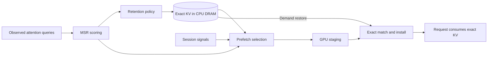

# MSR semantic cache for vLLM

An experimental vLLM extension for exact KV-cache offload, semantic retention,
and causal prefetch. The project explores **mean semantic relevance (MSR)** as a
cache policy alongside LRU and ARC.

**Development is paused.** This is a research prototype, not a production-ready
cache backend. The accepted experiments preserve exact output and KV identity,
but the combined MSR-retention and semantic-prefetch system has **not** shown a
repeatable provider benefit against matched ARC/LRU controls.

## Current standing

The strongest positive result is policy-agnostic. In E04, native
`store_threshold=2` reduced writes by 99.790% and improved the semantic arm's
mean TTFT by 22.50%, ITL by 19.78%, throughput by 14.93%, and makespan by 12.00%
versus its neutral configuration. Matched ARC also benefited from threshold 2
and remained ahead of semantic by point estimate: semantic TTFT was 3.17% worse,
ITL 4.76% worse, throughput 2.70% lower, and makespan 5.12% longer. Those cells
performed no restores or prefetches, so E04 supports a generic admission guard,
not a semantic-policy or prefetch win.

The final combined-system campaign reached exact causal semantic selection and
consumption, then closed as a scoped negative:

- A26 repeated three matched 48-request traces. MSR+semantic executed 120,174
  prompt tokens versus 119,918 for ARC/LRU in every trace (+0.2135%), used 3.56%
  more measured model-runner time than ARC, and transferred 12.40% more H2D data.
- A27 used one genuinely disjoint 48-request trace. MSR+semantic selected and
  consumed the returning source, but tied ARC/LRU on prompt work while using
  4.94% more model-runner time, with 6.23% worse median TTFT and 6.37% lower
  throughput than ARC.

These results rule out the tested revisions and inputs as release-benefit
evidence; they do not establish that MSR can never help. The
[curated evidence snapshot](evidence/README.md) gives the full denominators,
controls, hashes, and limitations.

## Architecture

MSR ranks exact KV candidates using compact summaries derived from observed
attention queries. Retention manages CPU-resident exact KV; prefetch can stage a
causally selected prefix back to GPU before demand. Exact prefix, model, adapter,
layout, and position identity—not semantic similarity—determine whether KV may
be installed and reused.



The package is named `semantic-offload` and targets a narrow prerelease vLLM
compatibility range. Reproduction requires pinned extension and vLLM revisions.
The tested DRAM comparisons explicitly set `store_threshold=2`; it is not a
global runtime default.

## How to use

Install the extension with its supported vLLM range:

```bash
python -m pip install -e '.[cache-affinity]'
```

MSR is selected through vLLM's KV connector configuration. The public helper
returns the complete configuration, including mean-semantic retention and its
paired semantic prefetch:

```python
import json

from semantic_offload.config import msr_kv_transfer_config

config = msr_kv_transfer_config(
    cpu_bytes_to_use=8 * 1024**3,  # 8 GiB CPU KV tier
)
print(json.dumps(config))
```

Pass that JSON to `vllm serve`:

```bash
vllm serve Qwen/Qwen2.5-1.5B-Instruct \
  --kv-transfer-config '{
    "kv_connector": "SemanticOffloadingConnector",
    "kv_connector_module_path": "semantic_offload.connector",
    "kv_role": "kv_both",
    "kv_connector_extra_config": {
      "spec_name": "SemanticOffloadingSpec",
      "spec_module_path": "semantic_offload.spec",
      "cpu_bytes_to_use": 8589934592,
      "method": "mean",
      "store_threshold": 2,
      "prefetch_budget_fraction": 0.05,
      "prefetch_selector": "semantic",
      "prefetch_score_max_age_ms": 1000
    }
  }'
```

The helper defaults to preemption-triggered semantic prefetch. Set
`prefetch_budget_fraction` to control how much of the GPU block pool may be
reserved speculatively; it must be greater than zero to enable prefetch. The
current implementation requires pipeline and context parallel sizes of one,
does not support MLA KV caches, and requires the vLLM version range declared in
`pyproject.toml`. Treat the configuration as experimental and pin both projects
when reproducing results.

### Experimental scoring controls

The existing scoring behavior remains the default: `scoring_mode="synchronous"`,
`scoring_schedule="continuous"`, `capture_stride=1`, and `scoring_search="flat"`.

For the single-worker ARC wait-hint experiment, `scoring_schedule="opportunity"`
retains bounded last-query snapshots instead of scoring every generation step.
Use `capture_stride=8` to sample fewer query-extraction steps. When at least two
eligible sources compete for insufficient staging space, the scheduler requests
scores only for their DRAM-resident prefix keys. When every source fits, ranking
is bypassed. A missing or expired snapshot retains an unscored fallback; scoring
can defer speculative submission for at most 50 ms, checked at scheduler steps.
Demand serving is never held for a score. Snapshot bounds are
`query_snapshot_max_age_ms=1000` and `query_snapshot_max_requests=256`. This mode
requires `instrumentation_only=true`, `eviction_policy="arc"`,
`shared_prefetch_scorer=true`, and mean-key/mean-head TP=1 scoring. It supports
synchronous scoring or experimental `scoring_mode="asynchronous"` with flat search.
It does not provide semantic retention updates. `scoring_schedule="capture_only"`
is an attribution control, not a serving recommendation.

Asynchronous scoring requires `preservation_events=true` and one dense KV group.
One executor owns the scoring stream. Pending jobs are bounded by
`async_scoring_max_queue_items=2` and `async_scoring_max_snapshot_bytes=67108864`;
the byte limit covers retained job tensors and conservative workspace, not the
whole process, durable cache, query bank, Python metadata or allocator reservation.
Overflow drops the newest observation. Results retain their original feature
timestamp and expire within `async_scoring_max_snapshot_age_ms=1000` (also bounded
by the query lease in opportunity mode). Request generations, cache residency
versions and reset epochs are checked through final consumption. Normal completion
preserves a bounded final-query lease; abort/reset invalidate stale results.
Pending CUDA host waits query the event and sleep for 500 microseconds between
checks. This reduces active CPU waiting but can delay result availability; OS
scheduling can add more than one interval. Cancellation retains live GPU inputs
until their completion fences finish.

The scoring audit measured about 71% less readiness-plus-executor CPU per job in
the continuous diagnostic. Its final opportunity-mode serving comparison still
failed the ARC target: throughput was 2.27–2.71% lower and median first-token latency
12.22–12.81% higher. Those products had no constrained scoring opportunities.
This supports experimental work reduction, not dependable ARC parity, ranking
utility or lower VRAM use. Qualification is limited to the tested dense TP1/PP1
eager runtime. See the local [audit report](output/scoring-audit/REPORT.md) and
[independent Astra review](output/scoring-audit/astra-acceptance.md) when retained.

`prefetch_preserve_gpu_prefix_cache=true` is a later experimental opt-in
(default `false`). It reserves speculative staging only from the contiguous
unhashed head of the native free-block queue, preserving reusable GPU prefix
entries for ordinary demand allocation. It can defer prefetch and reduce its
coverage; unsupported queue layouts defer staging safely.

A three-seed confirmation measured regular throughput at 81.252 versus ARC's
80.806 output tokens/s (+0.552%), with all six regular pairs positive. The
higher-concurrency aggregate was 0.168% below ARC, including one pair 1.588%
slower; one regular pair's median first-token latency worsened 16.480%. Earlier
prefetch also matched ARC in the allocator screen, so the option's causal speed
benefit remains unproven. Real prefetch consumption remained enabled, but these
products had no competitive semantic scoring jobs. See the retained
[throughput report](output/throughput-parity/REPORT.md) for results and limits.

`scoring_search="ivf"` enables approximate cluster routing followed by the existing
exact mean-key/mean-head dot-product score on visited rows. Defaults are
`search_min_pool=128`, `search_clusters=16`, `search_probes=4`, and
`search_exploration=8`. Small pools use the flat scan. The index rebuilds when the
summary pool changes; its maintenance cost must be included in comparisons.
Unvisited blocks receive no score or freshness update. Rotating exploration
reduces persistent omission on a stable pool; it does not guarantee recall under
churn. Shortlist ranks change rolling-score weights relative to exhaustive
ranking. Candidate search never authorizes reuse of inexact KV or arbitrary
noncontiguous prefixes. These controls are experimental and have no presumed
serving benefit.

Set `SEMANTIC_PROFILE_DIR` to write bounded per-process component aggregates.
They distinguish host wall time, thread CPU time, counters and sampled CUDA-stream
intervals (`SEMANTIC_PROFILE_CUDA_STRIDE=16`). CUDA samples are read only after
completion; the profiler adds no per-step synchronization. Nested scopes and
concurrent streams overlap, so totals are not additive. Histogram quantiles are
duration bounds. Compare observer-off runs for serving results and use separate
profiled runs for attribution. Final flushes retain unfinished-sample counts.

### Scoring efficiency trial

A bounded follow-up compared five observer-off configurations on cached dense
Qwen3-4B with six simulated agents and 12 background requests (45 requests per
configuration). Current semantic scoring produced 81.26 output tokens/s; work
reduction produced 81.89 (+0.78%), and both controls enabled produced 81.84.
Matched ARC demand remained ahead at 82.34. Median release-to-first-token time
was 3.149 s for current semantic, 2.738 s with work reduction and 2.743 s for ARC.
These are one-run point estimates; completion-dependent arrival/cache histories
and prompt work differ, so these are not isolated scoring-cost or significance
claims.

Only 11 blocks entered DRAM, with no competing eligible sessions. Production
IVF correctly stayed on flat fallback. A separate static replay of real query
and summary tensors forced IVF on this tiny pool: it was costlier than scanning,
with 100% top-1/top-3 recall but 88.0% mean top-8 recall over 24 correlated query
rows. Large-pool crossover remains unmeasured; keep the index disabled for this
workload.

A separate complete diagnostic placed 13.22 s of cumulative host time inside
construction of the tiny GPU gather-index tensor, versus 0.195 s inside scoring.
The upload span includes possible driver waiting/spinning for previous GPU work;
it is not 13 s of additional GPU computation or reclaimable latency. Device,
host and nested timing ranges overlap. This identifies a capture/synchronization
investigation seam rather than evidence that vector comparisons dominate.
Per-request results, complete component/queue/serialization measurements, exact
source pins and reproduction material are retained outside Git under
`output/scoring-efficiency/`. All nine real serving runs preserved exact output
and native KV identities; native direct adoption was not exercised because
prefetched prefixes were partial. This follow-up establishes no capacity or
production-policy win.

### Direct adoption of prefetched blocks

The experimental `wait_hint_native_adoption` option defaults to `false`. With
`prefetch_trigger="known_prefix_wait_hint"`, setting it to `true` lets a returning
request adopt the same physical GPU blocks that hold its completed prefetched
prefix, avoiding a second prefix allocation and the staging-to-destination copy.
It requires the companion [vLLM patch](patches/vllm-native-prefix-adoption.patch);
check the patch against the runtime checkout with `git apply --check` before
applying it. The patch was CPU-tested on the recovered prerelease runtime used
for the October opportunity screen, not every release in the dependency range.

The initial path supports a complete exact prefix with dense causal BF16 KV,
one worker, one KV group, and one hash per block. It publishes blocks only after
transfer completion and returning-request identity checks. Native cache lookup
then owns allocation, sharing, and eviction. Eviction before admission falls
back to demand restoration; unsupported configurations retain the existing
staging path. Missing runtime support also retains that path.

CPU tests verify allocator ownership and physical block reuse. A bounded GPU
validation also confirmed real transfer completion, the same physical prefix
blocks in the worker's CUDA block table, and exact generated outputs. Three
alternating-order pairs with lighter logging measured 41.9–42.3 ms from request
release to first token, versus 70.9–71.4 ms for matched project ARC demand
restoration. The test supplied the exact target prefix 750 ms in advance.
Background generation took 6.8–17.6 ms longer over roughly eight seconds; no
background-neutrality claim is made. Broader repeatability, capacity gains and
deployable prediction remain unverified. This option is a prototype and does not
change the default path.

A separate synthetic load trial used six agent sessions and twelve background
requests on Qwen3-4B, with live semantic capture/scoring and natural cache
admission. ARC demand produced 82.4 output tokens/s, request-order prefetch 82.3,
and semantic prefetch 77.8. Only one or two blocks became eligible per decision;
no full prefix used native adoption and no semantic decision had competing
eligible sessions. This trial showed no end-to-end semantic benefit. Each arm
ran once on generated sessions, not a production trace. The separate CPU-cost
optimizations were excluded from these measurements.

## Repository map

```text
.
├── semantic_offload/
│   ├── config.py                 Public vLLM/MSR configuration helper
│   ├── connector.py              Exact KV movement and semantic prefetch
│   ├── spec.py                   vLLM offloading spec and runtime options
│   ├── manager.py                Admission, residency, and eviction manager
│   ├── policy.py                 MSR retention policy
│   ├── index.py                  KV summaries and semantic scoring
│   ├── worker.py                 Worker-side scoring and transfers
│   ├── query_capture.py          Attention-query capture
│   └── wait_hint.py              Optional causal wait-hint schema
├── benchmarks/
│   ├── eviction_prefetch_campaign.py
│   ├── msr_combined_prefetch_workload.py
│   └── msr_combined_prefetch_attribution.py
├── harness/
│   ├── policies.py               LRU, ARC, and semantic configurations
│   └── server.py                 vLLM server launcher
├── tests/                        Correctness and measurement validation
├── evidence/
│   ├── README.md                 Results, denominators, and limitations
│   ├── e04/                      Threshold-2 admission report
│   └── a27/                      Final combined-system report and audit
├── docs/
│   ├── PROJECT_HISTORY.md        Experiment and milestone timeline
│   └── FUTURE_WORK.md            Untried optimizations and measurement gaps
├── pyproject.toml
└── uv.lock
```

See the [project history](docs/PROJECT_HISTORY.md) for the experiment timeline
and [future work](docs/FUTURE_WORK.md) for the unfinished optimization and
measurement backlog. Multi-gigabyte raw runs remain outside Git. No new GPU work
is scheduled while the project is paused.
