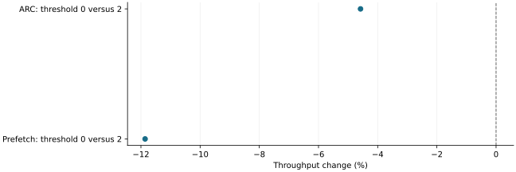

# Unrestricted admission filled the CPU cache but slowed serving

2026-11-10 · historical · negative

Removing the frequency gate filled the CPU cache, but throughput fell 4.58% for ARC and 11.86% for prefetch. More admitted bytes and more cache activity did not establish useful capacity.

Single fixed-order observations, no uncertainty interval. Negative is slower.

## Scope

Four fresh Qwen3-4B dense BF16 runs, 45 requests each, 1,440 MiB GPU KV and 448 MiB CPU KV. Thresholds 2 and 0 were compared with ARC retention in both policies; all 180 requests passed exactness and transfer checks.

## Limits

One run per arm in fixed order; closed-loop schedules and observer volume differ. Eleven admitted blocks at threshold 2 became 4,781/4,962 store events at threshold 0. No constrained semantic ranking occurred, and allocation peaks included startup.

## Decision

Retain admission as a cost control. The proposed bounded consecutive-prefix write policy was a design, not a tested win; CPU copies do not themselves release native GPU references.

## Sources

- [output/admission-trial/REPORT.md](../sources/26f6b4c4753e1001c6d76abc67704a0d1a8614f18141137729db47351974bb8c.json)
- [output/capture-optimization/BOUNDED-ADMISSION.md](../sources/fcbb1b496f8349828e8fb0991036459e5aa58967732dcdc0cf2bfb71c8b450e6.json)

Exact source hashes and figure inputs: [result.json](result.json).
