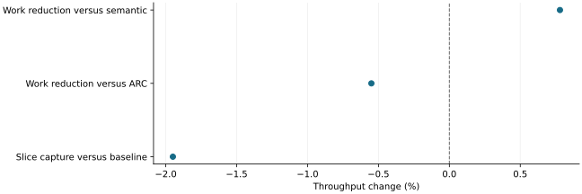

# Reducing capture work moved synchronization costs and did not establish a speedup

2026-11-10 · historical · mixed

Opportunity-only sampled scoring modestly improved the early semantic configuration, but ARC remained faster. Replacing query-index construction with slices moved much of its host wait to score readback rather than removing the cost.

Separate single-run studies and comparators; no pooled estimate or confidence interval.

## Scope

Dense Qwen3-4B BF16 eager simulated-agent experiments. The scoring-efficiency study covered nine lifecycles/405 exact requests; the separate slice/concatenate test covered four lifecycles/180 exact requests.

## Limits

Single-run product comparisons and different closed-loop histories. Indexed search used its tiny-bank fallback in serving; forced replay had routing/build costs and only 88.02% mean top-8 recall. Inclusive host timers overlap and cannot be added as GPU compute savings.

## Decision

Retain the synchronization lesson. The slice/concatenate candidate was restored after no measured product gain; indexing and lower capture cadence were not qualified as general improvements.

## Sources

- [output/scoring-efficiency/REPORT.md](../sources/6e290d10e5ce3c5ca26f7b3f7494100e5e60af3d98a58f2e01c0d6f09f51a6ab.json)
- [output/capture-optimization/REPORT.md](../sources/569ffca1385003bd4f37bfaf958dd994ae0b079a929b7699d2fb3770afa98289.json)

Exact source hashes and figure inputs: [result.json](result.json).
