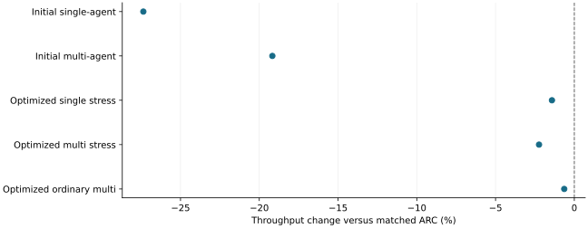

# Continuous semantic machinery imposed overhead even without useful cache activity

2026-11-10 · historical · negative

The October 2080 Ti matrix measured 27.36% lower single-agent and 19.17% lower multi-agent throughput than ARC. Later capture/batching changes substantially improved the original configuration but still missed the general within-1% target.

Separate studies/configurations, not one pooled experiment; negative is slower.

## Scope

Qwen2.5-1.5B FP16 eager on RTX 2080 Ti/WSL, matched small KV budgets. The initial normal matrix used three fresh-server seeds; later stress and ordinary confirmations also used three paired seeds.

## Limits

The initial normal matrix had no CPU eviction or consumed prefetch; single-agent scoring was inactive. Stress activated eviction but not prefetch. One ARC-only repeat confirmed baseline output instability. Later stress gaps include different cache work; skipping single-token observations changes score trajectories.

## Decision

Keep the inactive path cheap and measure end-to-end cost. Do not mistake feature enablement for opportunity, or the later ordinary -0.64% pooled result for universal equivalence.

## Sources

- [output/matrix-2080ti-20261031/REPORT.md](../sources/d8498f9d1a5accaa68ba8e53d8287ddf0ded7d4095a59f6cd38498402a7236b8.json)
- [output/matrix-2080ti-20261031/VALIDATION-ADDENDUM.md](../sources/1efd1b2e7cf0840acb1440a1ca84319c9b6e94f66cb0298fa0f66b2015875e75.json)
- [output/scoring-overhead-20261101/REPORT.md](../sources/e7a63c26bbb7a66602b269fec91ed1162994688875ded59679381ca0af6193ce.json)

Exact source hashes and figure inputs: [result.json](result.json).
