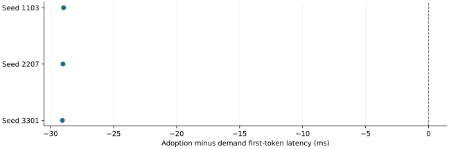

# Direct native adoption removed a splice and improved a privileged-target diagnostic

2026-11-10 · historical · supported

Correct-target prefetch initially showed no consistent latency benefit despite early transfer completion. Native publication of the staged physical blocks removed the second GPU prefix copy; a later lighter-logging demand comparison reached first token about 29 ms sooner in all three pairs.

Three low-logging paired observations on one privileged-target workload. Negative is sooner; no confidence interval.

## Scope

RTX 5080, Qwen2.5-1.5B BF16/TP1, one 2,048-token prefix, 56 MiB transfer and a privileged 750 ms correct-target lead. CPU integration preceded an old/adoption/old GPU check and then three balanced demand/adoption pairs.

## Limits

A small oracle-style diagnostic, not deployable prediction or independent deployment samples. Background neutrality, capacity gains, other layouts and GPU cancellation/failure injection were not established. Pool occupancy fell from duplicate 112 MiB to one 56 MiB copy, not smaller preallocated VRAM.

## Decision

Retain exact identity, completion fences and native ownership as the mechanism. Keep this historical speculative-adoption result separate from the current CPU-only hint policy.

## Sources

- [output/opportunity-runtime-recovery/WSL-REPORT.md](../sources/1ad191d1582cbc5e189be3b4ad40db5824cc716e62638c897ba5a0b3341316fa.json)
- [output/direct-block-adoption/adoption/REPORT.md](../sources/9cbc6838bbc131e9d7645db3ee0b85c2419feb0b87537a1a777d9de1d2dddfac.json)
- [output/direct-block-adoption/gpu/REPORT.md](../sources/7eb2ec08983a2cde183414826cd695b1e9e1672cca7aba1deb7d0f61892fced9.json)
- [output/direct-block-adoption/step1/REPORT.md](../sources/ff9a37055ec56a9506155a968909b8674dca0028487971a99a515a303decab53.json)

Exact source hashes and figure inputs: [result.json](result.json).
