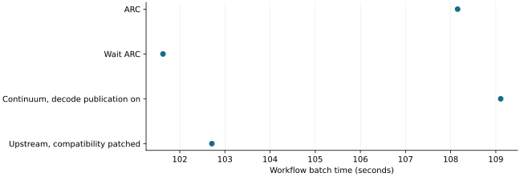

# Single-pass external comparisons did not establish a winner

2026-11-10 · historical · unresolved

The five-system exploration and corrected four-system comparison exposed configuration differences and similar wait/upstream batch times. Neither establishes a repeatable system ranking.

Corrected four-system comparison only. Lower is faster; one run per system, no uncertainty intervals.

## Scope

Corrected four-system study: one run per system, sixteen workflows, 64 responses and 48 tools each, Qwen2.5-7B-AWQ on RTX 2080 Ti.

## Limits

Runtimes, chunking, paging, output lengths and instrumentation differ. Continuum decode-publication correction was predeclared; the original false row remains diagnostic. Strict output-format compliance mostly failed.

## Decision

Keep published-system comparisons and their configuration corrections; do not treat token rate as equal-work throughput or label parity as quality equivalence.

## Sources

- [evidence/fair-four-20261104/README.md](https://github.com/philippesic/vllm-msr-cache/blob/1319f09bafac46bab89df465dd433c67441f4b26/evidence/fair-four-20261104/README.md)
- [evidence/fair-four-20261104/FAIRNESS.md](https://github.com/philippesic/vllm-msr-cache/blob/1319f09bafac46bab89df465dd433c67441f4b26/evidence/fair-four-20261104/FAIRNESS.md)
- [evidence/five-way-20261104/README.md](https://github.com/philippesic/vllm-msr-cache/blob/1319f09bafac46bab89df465dd433c67441f4b26/evidence/five-way-20261104/README.md)

Exact source hashes and figure inputs: [result.json](result.json).
