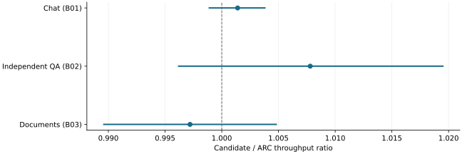

# An architecture-specific rebuild repaired 5080 transfers; the retained study is incomplete

2026-11-10 · historical · unresolved

The November 8 Continuum warmups failed because its binary lacked sm_120 or PTX. Rebuilding the same LMCache source repaired exact transfers and all required screens. The November 9 report remains a running-campaign snapshot. Three completed native control cells had throughput intervals spanning parity and no CPU restoration activity.

Retained interim 5080 control cells, whole-process paired log Student-t 95% intervals: 12 chat, 6 QA and 12 document pairs. No returning CPU restoration or eviction-affected returns; not a pressured-offload benefit or final campaign estimate.

## Scope

Same-source LMCache 0.3.6 rebuild; 393,216-byte bidirectional equality; 54 screening configurations and 22 matched blocks. B06 had 31 valid measurements out of 32 attempts and seven of eight complete blocks.

## Limits

One candidate attempt had zero restores and preemptions and remains excluded. Confirmation, overhead, operational and final audits were not complete at this revision. No final campaign result or GPU-only cross-host attribution is claimed.

## Decision

Retain the binary capability finding and incomplete-study boundary. New-code 5080 qualification remains deferred, not silently inherited.

## Correction

2026-11-10: made the already reported interim control-cell estimates visible; no additional acquisition or completion claim.

## Sources

- [evidence/stage6-5080-20261108/RESULTS.md](../sources/ddac83d85705be6435c128eec946fab974c29b51965bf0cf03363bd890be613a.json)
- [evidence/stage6-5080-20261109/RESULTS.md](../sources/9b320da8cf8ec55cb6725c3a44fc3958d7b51854dd84b21bc6322428292d6a42.json)
- [evidence/stage6-5080-20261109/lmcache-build.json](../sources/3ae829d44ab34eb1427b576fdfb76489826d9d598f88e0e5c9c7bc412a6368bd.json)

Exact source hashes and figure inputs: [result.json](result.json).
