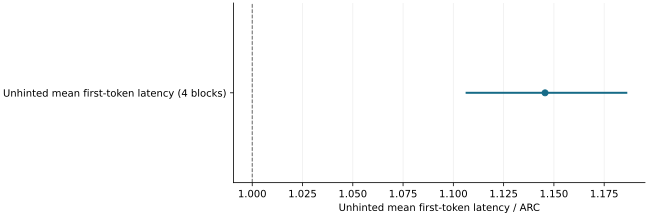

# Misleading hints harmed other traffic and quality equivalence remained unproved

2026-11-10 · historical · mixed

Enabled-without-hints QA throughput was 0.9667 of ARC (95% interval 0.9539–0.9797), leaving the declared 3% loss bound unresolved. Misleading hints increased unhinted first-token latency beyond the declared bound. Aggregate throughput concealed interference, and output audits retained factual, format and truncation failures.

Four misleading-advice blocks; original 95% interval. Above 1 is slower. The observed increase exceeded the declared 5% bound.

## Scope

Fresh QA: 24 pairs. Misleading-advice study: four advice blocks. Objective checks covered 10,616 primary and 3,504 addendum finals, with selected source reviews.

## Limits

Failure-selected review is not population accuracy. Per-process unhinted p99 had only sixteen requests. Completed workflows and served tokens are not correctness-adjusted utility.

## Decision

Require separate overhead, unhinted-traffic and output-validity accounting when interpreting future performance.

## Sources

- [evidence/stage6-2080ti-20261106/RESULTS.md](https://github.com/philippesic/vllm-msr-cache/blob/1319f09bafac46bab89df465dd433c67441f4b26/evidence/stage6-2080ti-20261106/RESULTS.md)
- [evidence/stage6-2080ti-20261106/quality-final-summary.json](https://github.com/philippesic/vllm-msr-cache/blob/1319f09bafac46bab89df465dd433c67441f4b26/evidence/stage6-2080ti-20261106/quality-final-summary.json)

Exact source hashes and figure inputs: [result.json](result.json).
