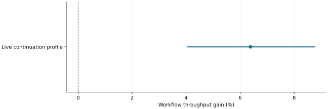

# Live continuation gains supported only a constrained operating profile

2026-11-10 · historical · supported

Fresh live workflows supported controlled asynchronous continuation/status drafts with human review on the exact tested implementation. The original assessment did not qualify general interactive serving.

Original fresh paired estimate and 95% interval for the tested profile; higher is better.

## Scope

Correctness-normalized native ARC; common patched runtime, return credit, 1,536 GPU and 2,048 CPU blocks. The exact installed-wheel/overlay identity is retained in the source.

## Limits

Cold/burst delays, registry lifetime management and conditional trace coverage constrain the result. Later runtime and instrumentation changes are outside this qualification.

## Decision

Preserve the operating limits alongside the gain; do not transfer qualification automatically to the new implementation.

## Sources

- [evidence/live-optimization-2080ti-20261103/operational-final-root-assessment.json](https://github.com/philippesic/vllm-msr-cache/blob/1319f09bafac46bab89df465dd433c67441f4b26/evidence/live-optimization-2080ti-20261103/operational-final-root-assessment.json)
- [evidence/live-optimization-2080ti-20261103/qualified-live-profile.json](https://github.com/philippesic/vllm-msr-cache/blob/1319f09bafac46bab89df465dd433c67441f4b26/evidence/live-optimization-2080ti-20261103/qualified-live-profile.json)

Exact source hashes and figure inputs: [result.json](result.json).
