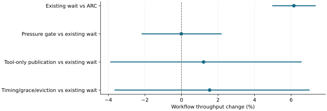

# Faster eviction did not translate into a qualified serving optimization

2026-11-10 · historical · unresolved

No new optimization qualified beyond existing wait hints. Large eviction calls sped up substantially, but eviction occupied less than 0.05% of primary/tight workflow time and only 0.09% in the larger-document diagnostic.

Three-repetition development panels. Different candidate comparisons are shown separately; higher is faster.

## Scope

144 valid development cases plus two invalid configurations. Selected timing and pressure panels used three repetitions; exact-state CPU replay examined native decisions.

## Limits

Development-selected inputs are not independent confirmation. Some mechanisms never activated, so their value remains unresolved rather than disproved.

## Decision

Keep the simple candidate. Preserve microbenchmark gains as diagnostics and require end-to-end value before importing faster eviction or inactive bridges.

## Sources

- [evidence/stage5-optimization-20261105/README.md](https://github.com/philippesic/vllm-msr-cache/blob/1319f09bafac46bab89df465dd433c67441f4b26/evidence/stage5-optimization-20261105/README.md)
- [evidence/stage5-optimization-20261105/EVICTION.md](https://github.com/philippesic/vllm-msr-cache/blob/1319f09bafac46bab89df465dd433c67441f4b26/evidence/stage5-optimization-20261105/EVICTION.md)
- [evidence/stage5-optimization-20261105/EXHAUSTION.md](https://github.com/philippesic/vllm-msr-cache/blob/1319f09bafac46bab89df465dd433c67441f4b26/evidence/stage5-optimization-20261105/EXHAUSTION.md)

Exact source hashes and figure inputs: [result.json](result.json).
