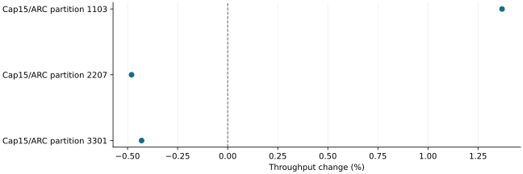

# Less speculative waste did not establish a better serving frontier

2026-11-10 · historical · negative

At the smallest pool, a reclaim backoff cut unused speculative traffic by 56.4% but remained 6.80% slower than ARC. A 15% reservation cap initially helped near the memory knee, then failed to repeat that speed advantage on two additional partitions.

Descriptive comparisons with unequal generated histories, not identical-work repetitions.

## Scope

Fourteen accepted 72-request runs on 2080 Ti/WSL with 7B AWQ, 672 or 1,792 MiB GPU KV and 3.5 GiB CPU KV. Real public-content sessions with simulated waits; backoff and cap are different controls.

## Limits

All ten cross-arm comparisons had output differences; nine had later prompt/key differences. Three failed/incomplete attempts remain excluded, including a physical-proof hole at the intermediate memory budget. Lower concurrent reservation does not necessarily mean less cumulative traffic.

## Decision

Keep reclaim churn and reservation coverage as costs to measure. Neither backoff nor a smaller cap was qualified to replace defaults or extend the low-memory range.

## Sources

- [output/prefetch-efficiency-20261101/REPORT.md](../sources/59e94c47dca7eac5ba2d56f3fdcf1a77f5537dc471e53b0683805d50bbd31739.json)

Exact source hashes and figure inputs: [result.json](result.json).
