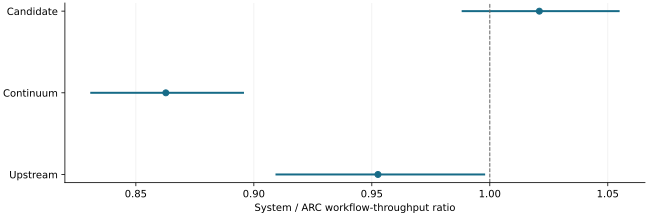

# The separate repository-pressure recovery left the candidate gain unresolved

2026-11-10 · historical · unresolved

The original addendum failed before serving. A separately authorized recovery completed eighteen configurations, including four complete four-system pressure blocks. Candidate versus ARC remained inconclusive.

Four complete pressure blocks; original paired 95% intervals. Above 1 is faster. External systems differ in runtime and outputs.

## Scope

Every ARC pressure block had 25 eviction-affected returns. All 288 finals and selected 272 source-review items were audited.

## Limits

The recovery is a separate experiment and does not erase the failed attempt. Four blocks do not establish a general winner; quality equivalence remains unproved.

## Decision

Keep the failed original and completed recovery distinct. Do not call an unresolved gain either a win or proof of equivalence.

## Sources

- [evidence/stage6-2080ti-20261106/repository-recovery-03/README.md](../sources/733ffd69ebd1717244c156c06173f385559abe6bf797f08c73abc66a37eb5796.json)
- [evidence/stage6-2080ti-20261106/repository-recovery-03/comparisons.json](../sources/3f046c3d1c4d1d1c4724bca4bcbadc237dbef32d990abc2c462c450863350628.json)

Exact source hashes and figure inputs: [result.json](result.json).
