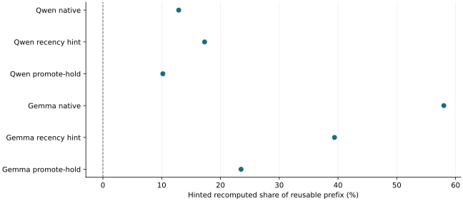

# Promote-hold wait advice cut recomputation in aggregate but missed its pre-registered rule

2026-11-12 · current · mixed

Promote-hold (native touch of the ready prefix, then a capped hold until return or deadline) beat the recency hint in every discriminating simulator scenario and pooled engine totals: hinted recomputed share 10.2% versus 17.3% on Qwen and 23.5% versus 39.4% on Gemma, with unhinted sessions no worse than advice-disabled. The rule required it to be no worse in every engine repetition; Gemma seed 201 was worse (14,400 versus 13,632 tokens), and three of four Qwen repetitions were exact ties. Recency stays the default; promote-hold remains opt-in.

Pooled over four seeds per arm (gpu-only and oracle: one seed). Lower is better. No uncertainty intervals; repetition-level differences can be within A/A noise.

## Scope

RTX 2080 Ti, WSL2, pinned vLLM. Multi-session pressure benchmark: Qwen3.5-4B AWQ (36 GPU blocks, 100 x 16.5 MiB CPU keys) and Gemma 4 12B AWQ (native GPU KV, 2560 MiB pool, model workload override), seeded token-ID shape replay of 4-5 concurrent sessions plus one-shot competitors, one hint per wait. Four repetitions per arm per model (smoke seed 102 plus 201/209/216); all control and comparison cells valid except one Gemma native cell without CPU restores. CPU trace replay through the real pinned ARC policy and manager, 15 scenarios.

## Limits

Four repetitions only; Qwen's native A/A pair differed by 11 points at seed 102, so single-seed differences are within noise. Simulator arrival times are arm-independent and its attention-style GPU reuse overstated GPU hits on these hybrid models; calibrated scenarios disable it. Gemma cells after 22:14 PST ran with a virtual display holding about 319 MiB (GPU KV 9,676 instead of 12,367 tokens). LMCache restore and eviction counters were not observable. No application-level or full-campaign evidence.

## Decision

Do not adopt under the fixed rule: keep recency as the default and retain promote-hold as an opt-in experimental mechanism for Philip's decision. The pressure benchmark with controls, activity contracts and a pre-GPU simulator check is the maintained instrument; a full 3-seed run of all arms is projected at about 1.9 GPU hours and more seeds are needed to resolve repetition-level differences. CPU-restored Gemma KV was byte-identical to stored blocks (2,832 of 2,840 written blocks; the rest fit the recomputed tail), so the earlier Gemma soak mismatch reflects cache-path numerics at different boundaries, not faulty restore.

## Sources

- [results/promote-hold-advice/evidence.json](../sources/86d412924150eb694cc4131be24d1747320b3bec1d54211b39aca75052493262.json)

Exact source hashes and figure inputs: [result.json](result.json).
