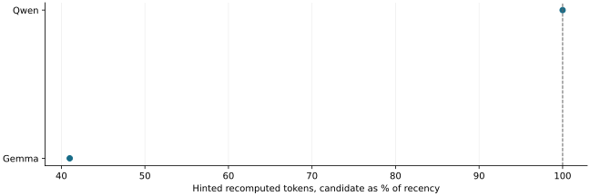

# Eight more seeds per model kept the recency wait hint: promote-hold gained on Gemma but not on Qwen

2026-11-13 · current · negative

Under a pooled rule fixed before the runs, promote-hold cut Gemma hinted recomputation to 0.41 times recency's (not worse in 7 of 8 seeds) but was 14.7 points worse on seed 305. On Qwen it exactly tied recency in total (45,408 tokens each) and raised unhinted recomputation 4.7 points over advice-off. Recency stays the wait-hint mechanism; promote-hold stays opt-in. CPU-restored Gemma KV is byte-identical across the restored prefix.

Pooled over eight new seeds per model, all cells valid. Below 85 meets R1's benefit ratio; R1 also needs not-worse in three quarters of seeds, and R2/R3 apply separately. Single observations per seed and arm, no intervals.

## Scope

Second round after results/promote-hold-advice, same candidate, cap, workloads and pools (definition hashes equal). Eight fresh cohort-checked seeds per model (Qwen 301-315, Gemma 302-311), arms advice-off, recency and promote-hold, one server per arm; all 48 cells valid, Gemma GPU KV 9,676 tokens throughout. A/A repeats of advice-off on two seeds per model. Runtime CPU lane and dense GPU lane passed on the final code.

## Limits

Qwen's A/A noise (4.9 and 6.2 points hinted, 3.1 points unhinted on one seed) is as large as its candidate-versus-recency differences, so the Qwen failures say no benefit was shown rather than that harm was measured precisely. Gemma's unhinted A/A noise reached 14.9 points on one seed. The pre-GPU check simulated contiguous seeds rather than the chosen list. LMCache was not part of this round.

## Decision

Keep recency (R1 and R3 fail on Qwen, R2 fails on Gemma; R4 and R5 hold). Nothing retired. Promote-hold remains an opt-in experiment: in tight pools its 50% hold cap ignores in-flight store demand, which on Gemma evicted fresh prefixes before their hints (first-round seed 201) and is the likely cause of its weak seeds. Gemma exactness is closed: every block of the restored 1,536-token prefix matched stored bytes; the only differing blocks hold the recomputed boundary token and decode positions.

## Sources

- [results/promote-hold-settle/evidence.json](../sources/396dc116d66edd8768cc29c6695395a695ae29e406dceb0c8e62edfdc05c0b51.json)

Exact source hashes and figure inputs: [result.json](result.json).
