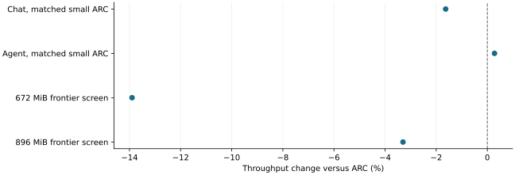

# Public quantized workloads did not show a better prefetch memory frontier

2026-11-10 · historical · negative

With public chat and recorded agent content, smaller-cache ARC achieved the same memory saving. The candidate missed the matched-ARC 1% chat target, while agent gains varied with generated histories. An eight-budget screen did not extend the useful low-memory range.

First two are paired geometric changes across three partitions; last two are separate one-pass screen observations. No common uncertainty estimate.

## Scope

RTX 2080 Ti/WSL, Qwen2.5-7B-Instruct-AWQ, FP16, 3.5 GiB CPU KV. Three paired corpus partitions in the translation study; a separate one-partition GPU-budget screen had 14 valid points and two proof-invalid holes.

## Limits

Tool observations and wait durations were replayed/simulated rather than produced by live tools. Agent histories differed across arms; no exact-work causal gain. At 672 MiB the candidate consumed only about 3.2% of speculative traffic for its named demand. Strict-invalid points remain excluded.

## Decision

Right-size the ARC control first. Keep shared-prefix/JIT publication functionality distinct from policy value, and retain reservation waste, preemption, latency and proof failures when considering future designs.

## Sources

- [output/quantized-realworld-20261101/REPORT.md](../sources/c240d62b38154ddd0ba5e81e388f80e58ba4562c897de0889c8b07036fe5b9b3.json)
- [output/vram-frontier-20261102/REPORT.md](../sources/88144b3fcd8de93c0980843edbaaf13cf3afe57ecd6150827dff575b23fe6a2f.json)

Exact source hashes and figure inputs: [result.json](result.json).
