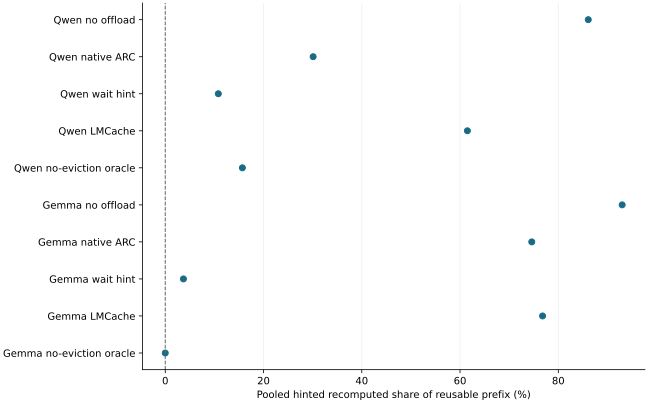

# In the full pressure campaign the reachable-hold wait hint beat native CPU offload and LMCache on both models

2026-11-13 · current · supported

With reachable-hold adopted, the full pressure profile ran six arms on both models. Pooled hinted recomputation fell from 30.1% (A/A repeat 38.6%) with native ARC to 10.8% with the wait hint on Qwen, and from 74.6% to 3.7% on Gemma, where unhinted recomputation also fell from 64.8% to 3.3% because unreachable sliding-window keys go first. Qwen unhinted was level (35.2% against 32.8% and 42.4%). Mean hinted TTFT fell from 980 to 705 ms on Qwen and from 2915 to 1121 ms on Gemma. LMCache with the same nominal bytes recomputed 61.5% and 76.8%.

Three seeds per model, all 36 cells valid. Lower is better. Single observations, no intervals; Qwen A/A noise is about 8 points pooled.

## Scope

Profile full, seeds 305, 308 and 312, one server per model and arm (gpu-only, native-arc, native-arc-repeat, wait-hint, lmcache, oracle) on code revision 01740159; all 36 cells valid under verify-pressure with no store failures. Qwen pool 60 keys of 16.5 MiB, Gemma 2560 MiB with 9,676 GPU KV tokens (a virtual display holds about 292 MiB). 80 GPU minutes on an RTX 2080 Ti.

## Limits

Three seeds and single observations per arm, no intervals. Qwen's advice-off A/A repeat differed by 8.4 points pooled and up to 11 points per seed, so Qwen gaps smaller than that are noise; Gemma's repeat matched exactly. The no-eviction oracle reached 0% on Gemma but 15.7% on Qwen, above the wait hint, because Qwen losses are mostly the pinned vLLM hybrid lookup discarding complete CPU copies rather than evictions; one Qwen seed's gap to the oracle is unexplained. LMCache restore and eviction counters are unobservable, so its cells are judged only by the contracts it can satisfy. One synthetic multi-session workload on one GPU; no application-task quality is measured.

## Decision

Keep reachable-hold as the only wait-hint mechanism. No change to product or benchmark code. Further Qwen gains would require the pinned vLLM hybrid lookup to consult the connector for a CPU copy beyond a diverged GPU hit, which is outside this extension.

## Sources

- [results/reachable-hold-campaign/evidence.json](../sources/bd76d9c39ecdbe3b4cdfbfddfdf4d71076b53e9a0a57409d1b8b6601f2dba5cb.json)

Exact source hashes and figure inputs: [result.json](result.json).
