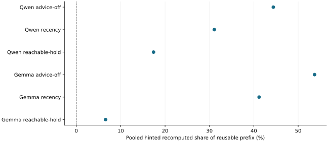

# Reachable-hold replaced the recency wait hint after passing the pre-fixed rule on both models

2026-11-13 · current · supported

Reachable-hold promotes and holds a waiting session's ready prefix, releases holds earliest deadline first when an eviction would otherwise fail, and lets the session's unreachable sliding-window and recurrent keys be evicted first. Under the settle-round rule, fixed in commit 20b56941 before any run, it cut pooled hinted recomputation from 31.1% to 17.4% on Qwen (0.56 times recency, not worse in 7 of 8 seeds) and from 41.2% to 6.6% on Gemma (0.16 times, 8 of 8), and lowered unhinted recomputation below advice-off on both. It is now the only wait-hint mechanism. Qwen's earlier flat ~20% came mostly from a pinned-vLLM hybrid lookup effect and an oversized pool, not eviction.

Eight seeds per model, all cells valid. Lower is better. Single observations per seed and arm, no intervals; Gemma A/A noise reached 27 points on one seed.

## Scope

Eight fresh cohort-checked seeds per model (Qwen 401-412, Gemma 401-416), arms advice-off, recency and reachable-hold, one server per arm, plus advice-off A/A repeats on two seeds per model; all 52 cells valid with no store failures. Qwen pool 60 keys of 16.5 MiB (0.6 of the working set at the measured 2.5 keys per chunk; earlier rounds used 100), Gemma 2560 MiB with 9,676 GPU KV tokens. The pre-GPU simulator ran the exact seed list. Runtime CPU lane and dense GPU functional lane passed on the adopted code.

## Limits

Single observations per seed and arm, no intervals. Gemma's advice-off A/A differed by 26.9 points hinted on seed 401 (Qwen's repeats were identical), so per-seed Gemma differences are noisy; the pooled gap (41.2% versus 6.6%) is far larger. The Qwen pool was resized in this round, so its numbers are not comparable with earlier rounds. Returns at a shorter boundary than the hint (compaction) can lose marked keys. The pinned vLLM hybrid lookup effect still costs every arm on Qwen and is not fixed here. No LMCache, application-level or long-run evidence in this round.

## Decision

Adopt reachable-hold (R1-R5 hold on both models). Recency and promote-hold are deleted from product, simulator and benchmark; the advice_mechanism setting and the benchmark's candidate arm are removed. The diagnosis: a debug-logged Qwen cell showed every full loss with a complete CPU copy was vLLM asking the connector only beyond a GPU full-attention hit that lacked Mamba state and then discarding both; the remainder were compaction returns without a stored 528-token checkpoint. Reporting or patching that vLLM behavior is separate work.

## Sources

- [results/reachable-hold-decide/evidence.json](../sources/5237ec2d8ae951970a18862bb2a08b8c166851366497f20f2a3af45268c5b1bc.json)

Exact source hashes and figure inputs: [result.json](result.json).
