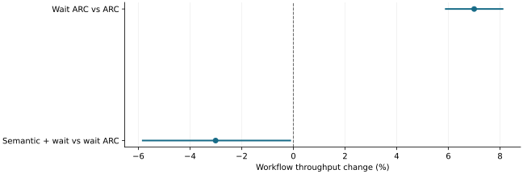

# Real tool waits exposed recency benefits and output-dependent comparisons

2026-11-10 · historical · supported

An initial two-pair repository workflow was diagnostic. A later three-repeat pressure study measured higher workflow throughput from early CPU wait hints; adding semantic retention provided no incremental gain.

Three whole-case paired repetitions on fixed inputs; original 95% intervals. Higher is faster.

## Scope

Pressure study: Qwen2.5-7B-AWQ, RTX 2080 Ti, decode graphs, nine cases, 576 responses and 432 actual tools. Initial study: four cases and 128 responses.

## Limits

Later live prompts/outputs differ. These are closed-loop workflow results, not identical-work policy attribution. Narrow test-status correctness does not establish general answer quality.

## Decision

Retain actual tool waits and demonstrated cache competition as useful experimental ingredients, without fixing the product to these workloads.

## Sources

- [evidence/real-agent-eval-20261104/README.md](../sources/0edefabd69d0ba106ad7841a1e9be40f1e45a19995863458f84527f917f2339f.json)
- [evidence/wait-opportunity-20261104/README.md](../sources/7489a9997ed06bc35272c18529b1915b56396975dccb9328c2f0370839e90b4a.json)

Exact source hashes and figure inputs: [result.json](result.json).
