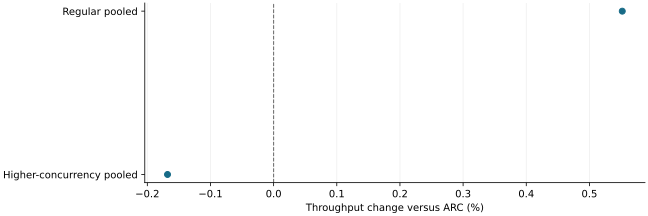

# Preserving cached GPU prefixes reduced direct eviction but did not prove universal parity

2026-11-10 · historical · mixed

Restricting speculative allocation to the unhashed free-queue head changed directly erased cached blocks from eight per run to zero. Regular-load pooled throughput was 0.552% above ARC; higher-concurrency throughput and latency exceptions remained.

Descriptive pooled changes from separate workload regimes; no equivalence interval.

## Scope

Qwen3-4B BF16 eager, six regular paired comparisons over three seeds and three higher-concurrency pairs. Confirmation completed 810 exact requests; the allocator screen separately established the direct-eviction mechanism.

## Limits

Old staging also exceeded ARC in the fresh screen, so the historical slowdown was not reproduced and the throughput gain is not causally attributable to the patch. Organic score jobs were zero. One regular pair had 16.48% worse median first-token latency.

## Decision

Preserve the distinction between native free blocks and empty cache entries. Lower speculative coverage traded against direct eviction; no general latency, capacity or ranking benefit was established.

## Sources

- [output/throughput-parity/REPORT.md](../sources/5430bfe66abd64e910e95593c99d5086b8b397de24628118884d98f06804775b.json)

Exact source hashes and figure inputs: [result.json](result.json).
