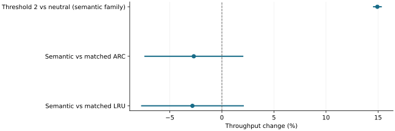

# Admission thresholds helped; semantic admission did not beat matched caches

2026-11-10 · historical · negative

The policy-agnostic store threshold sharply reduced writes. Adding semantic/cost-aware admission did not establish an incremental serving benefit over matched ARC or LRU.

Reported paired seed-level 95% intervals. Different comparisons answer different questions; higher is faster.

## Scope

420 valid cells, 10,500 requests, five seeds and four workload profiles on RTX 5080. Matched output-token digests and block identities agreed.

## Limits

No loads, restores or prefetches occurred. Threshold effects cannot be interpreted as a retention or prefetch win; results belong to the earlier implementation.

## Decision

Preserve threshold admission as a separate hypothesis. Do not revive semantic admission solely from its improvement over an unguarded baseline.

## Sources

- [evidence/e04/E04-FINAL-RESULT.md](https://github.com/philippesic/vllm-msr-cache/blob/1319f09bafac46bab89df465dd433c67441f4b26/evidence/e04/E04-FINAL-RESULT.md)
- [evidence/september-2026.md](https://github.com/philippesic/vllm-msr-cache/blob/1319f09bafac46bab89df465dd433c67441f4b26/evidence/september-2026.md)

Exact source hashes and figure inputs: [result.json](result.json).
