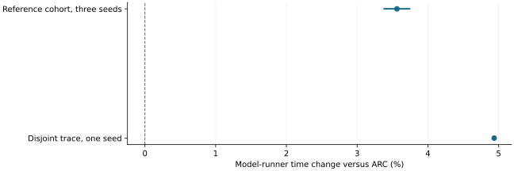

# Useful speculative transfers did not establish downstream benefit

2026-11-10 · historical · negative

The three-seed reference experiment selected a nonreturning source and wasted speculative traffic. A disjoint trace consumed every staged byte but only tied demand controls in executed prompt work and took more model-runner time.

Higher is slower. Reference interval is the original small-sample normal approximation; the disjoint point has no interval.

## Scope

40 accepted cells and 1,944 exact requests overall. The reference supplement has three seeds on one input cohort; the disjoint supplement has one independent trace.

## Limits

Current-stream instrumented GPU timings are not uninstrumented production cost. The disjoint trace has no uncertainty interval. This rejects the tested release claim, not every possible semantic predictor.

## Decision

Keep the negative result and require evidence of saved work or useful latency before interpreting transfer activation as benefit.

## Sources

- [evidence/a27/FINAL-REPORT.md](https://github.com/philippesic/vllm-msr-cache/blob/1319f09bafac46bab89df465dd433c67441f4b26/evidence/a27/FINAL-REPORT.md)

Exact source hashes and figure inputs: [result.json](result.json).
