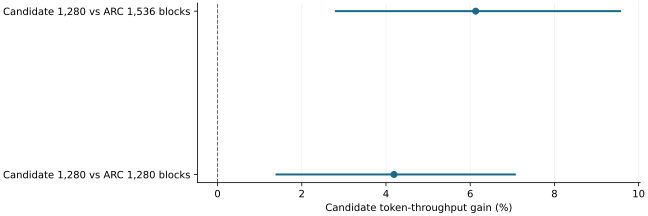

# Lower serving memory retained gains but increased preemptions

2026-11-10 · historical · mixed

Reducing the candidate to 1,280 GPU KV blocks saved 224 MiB versus native ARC at 1,536 blocks while improving measured throughput. Startup memory did not improve, and the candidate incurred 23 preemptions.

Whole matched-workflow nominal 95% intervals on three fixed traces; higher is better.

## Scope

Thirty-six invocations: twelve matched triples across three previously used public traces, 2,592 natural-EOS responses; equal 1.75 GiB CPU cache.

## Limits

Positive-wait return-tail improvement was unresolved. No host-RAM or universal tail claim follows. Separate startup-loading prototypes were rejected or interrupted; their partial findings are retained in [paused loading](../paused-loading/result.md).

## Decision

Retain serving-memory savings as a scoped result. Do not import the paused loading prototype or claim reduced startup memory.

## Correction

2026-11-10: linked the separately retained partial loading evidence; measurements unchanged.

## Sources

- [evidence/vram-frontier-2080ti-20261103/README.md](../sources/5862100cb703430d1ba5995f0717ccb97d4b20b8fa58d451f027b0cba74b6e1f.json)
- [evidence/vram-frontier-2080ti-20261103/confirmation.json](../sources/ed768c25ed631c8e3ca1d1e83222fc585b7009eb9f50450b00af9a59a597a7f3.json)

Exact source hashes and figure inputs: [result.json](result.json).
