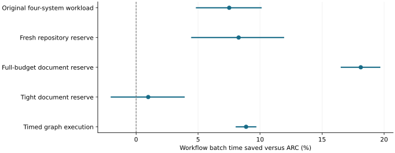

# Staged qualification found scoped gains and unresolved operating boundaries

2026-11-10 · historical · mixed

The selected four-stage study supported continuing CPU wait retention, including causal diagnostics and fresh repository/document reserves. Several tighter or alternative regimes remained unresolved.

Distinct fixed-input studies, not pooled. Original conditional paired 95% intervals; higher is faster.

## Scope

Earlier pinned RTX 2080 Ti runtime, FP16 TP1. Eight functional cells included 7B AWQ, 1.5B and OPT125M, short/long contexts and selected graphs; separate cells do not qualify their cross-product.

## Limits

Live output and runtime differences limit attribution. Answer-quality and production reliability gates were unmet. Earlier model support does not qualify current code.

## Decision

Keep causal controls, adverse cases and exact support boundaries as design knowledge. Do not carry old production or compatibility claims forward.

## Sources

- [evidence/wait-qualification-20261105/README.md](https://github.com/philippesic/vllm-msr-cache/blob/1319f09bafac46bab89df465dd433c67441f4b26/evidence/wait-qualification-20261105/README.md)
- [evidence/wait-qualification-20261105/SUPPORT_MATRIX.md](https://github.com/philippesic/vllm-msr-cache/blob/1319f09bafac46bab89df465dd433c67441f4b26/evidence/wait-qualification-20261105/SUPPORT_MATRIX.md)
- [evidence/wait-qualification-20261105/REGRESSIONS.md](https://github.com/philippesic/vllm-msr-cache/blob/1319f09bafac46bab89df465dd433c67441f4b26/evidence/wait-qualification-20261105/REGRESSIONS.md)
- [evidence/wait-qualification-20261105/QUALITY.md](https://github.com/philippesic/vllm-msr-cache/blob/1319f09bafac46bab89df465dd433c67441f4b26/evidence/wait-qualification-20261105/QUALITY.md)

Exact source hashes and figure inputs: [result.json](result.json).
