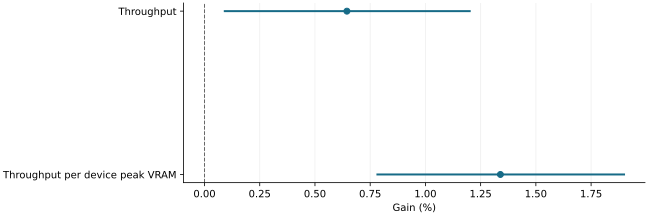

# CPU recency advice traded a small replay-rate gain for latency costs

2026-11-10 · historical · mixed

Exact recorded-output serving replay established a small throughput gain while saving 56 MiB of GPU cache capacity. It did not establish a general interactive-latency or generation-quality benefit.

Original whole-workflow paired Student-t 95% intervals, conditional on three traces. Higher is better.

## Scope

Twelve fresh matched workflow pairs, 1,728 exact requests, three fixed traces; Qwen2.5-7B-AWQ FP16 on RTX 2080 Ti/WSL2. Candidate 2,048 GPU blocks versus ARC 2,112; equal CPU capacity.

## Limits

Recorded-output replay is not free generation. Earlier pilots and failed confirmation are excluded from the fresh estimate and retained in the source. Latency regressions limit adoption.

## Decision

Keep as evidence that simple recency advice can matter; assess latency and useful work separately when developing it.

## Sources

- [evidence/cpu-wait-recency-2080ti-20261102/result.json](https://github.com/philippesic/vllm-msr-cache/blob/1319f09bafac46bab89df465dd433c67441f4b26/evidence/cpu-wait-recency-2080ti-20261102/result.json)

Exact source hashes and figure inputs: [result.json](result.json).
