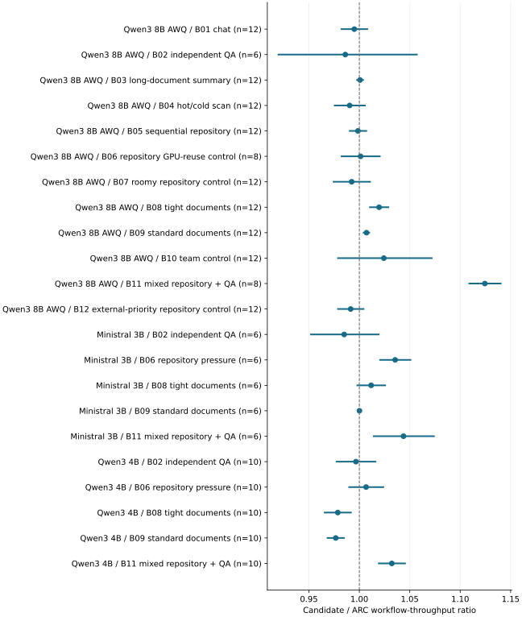

# Wait-hint gains and losses depended on model and workload

2026-11-10 · historical · mixed

The primary matrix found a strong mixed-traffic gain on Qwen3-8B, smaller or unresolved changes in many cells, and document losses on Qwen3-4B. Continuum was faster on the anchor document workloads.

All 22 native cells; original whole-process log Student-t 95% intervals. Above 1 is faster; B06 anchor is a no-CPU-pressure control.

## Scope

524 configurations and 210 matched blocks on RTX 2080 Ti/WSL2. Twelve anchor workloads and five each on two secondary models; external systems cover selected anchor workloads.

## Limits

Whole-process conditional intervals are not multiple-comparison-adjusted winner tests. External runtime/chunking/output differences prevent pure policy attribution. The anchor B06 had zero returning CPU restores and is a GPU-reuse control.

## Decision

Preserve the entire native comparison panel, including losses and neutral cells. Benefit is an observed result of a configuration, not an assumed universal property.

## Sources

- [evidence/stage6-2080ti-20261106/RESULTS.md](../sources/7b7a1cbb180f74f6538129a643664bbe4f455956cf94559ec135bec228ccd972.json)
- [evidence/stage6-2080ti-20261106/quality-final-summary.json](../sources/3abbca1d7a687bd7394a73ad0e2142b74914d562a8c6ba87ffcffc84e1573bcb.json)

Exact source hashes and figure inputs: [result.json](result.json).
